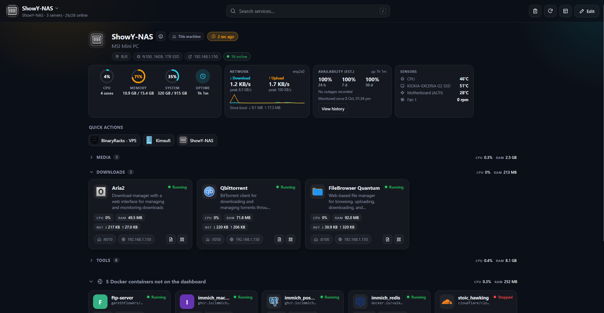

# ShowY Dashboard

**A lightweight, self-hosted dashboard for your homelab.** Organize services, inspect Docker containers, and monitor multiple machines from one interface.

 [](https://github.com/shirishsaxena/ShowY-Dashboard/pkgs/container/showy-dashboard) 

Node.js backend, plain HTML/CSS/JavaScript frontend, local JSON storage. **No database, package installation, or frontend build step.**



[Server monitoring](screenshots/server-monitoring.png) · [Remote dashboards](screenshots/remote-dashboards.png) · [Shared clipboard](screenshots/shared-clipboard.png) · [Settings](screenshots/settings.png)

## Features

| Area | Included |
| --- | --- |
| Service directory | Docker, Web, and Bookmark cards; groups, favorites, drag-and-drop ordering, icons, notes, and multiple labeled URLs |
| Card previews | Full descriptions and notes, links, status, and an edit shortcut; available across service types |
| Docker inspection | Container discovery, health, configuration, ports, networks, mount destinations, and per-container CPU/RAM/network/disk I/O snapshots |
| Docker logs & control | Numbered log snapshots with refresh/download; opt-in Start/Restart/Stop with confirmations and busy-state protection |
| Host monitoring | CPU, RAM, disks, network speed/history, uptime, temperatures, fans, and system information |
| Remote dashboards | Read-only aggregation of other instances, with stale/unreachable indicators |
| History | Estimated host availability and outages; persistent action history in the notification bell |
| Everyday tools | Shared clipboard with history, link/copy shortcuts, search, QR codes, and configuration import/export |
| Appearance & access | Card/compact/list layouts, light/dark themes, accents, installable PWA, and optional password protection |

## Quick start

**Recommended:** Linux, Docker, and Docker Compose.

1. Save [docker-compose.example.yml](docker-compose.example.yml) as `compose.yaml` in a new deployment directory.
2. Set `DASHBOARD_PASSWORD` and adjust ports or mounts as needed. The example publishes **8011 → 8080**, persists data in `./data`, and limits the container to **128 MiB RAM / 0.5 CPU**.
3. Start it:

   ```sh
   docker compose up -d
   ```

4. Open **http://SERVER_IP:8011**. Select **Edit**, add a server, mark the local host as **This machine**, then add services manually or from the discovered-container list.

The image is `ghcr.io/shirishsaxena/showy-dashboard:latest`. Pin a published version tag for reproducible deployments; see [Releases](https://github.com/shirishsaxena/ShowY-Dashboard/releases).

> The supplied example starts without a password and publishes on all interfaces. That configuration is for a trusted LAN only. Docker socket access remains privileged even with a read-only mount.

### Update

```sh
docker compose pull
docker compose up -d
```

Keep the same data volume, back it up before upgrades, and reload open dashboard tabs after deployment.

### Host mounts

The example mounts the Docker socket, host root for disk capacity, and host process information. Remove mounts for features you do not need; prefer narrower disk mounts where practical.

| Container path | Purpose |
| --- | --- |
| `/data` | Writable configuration, history, sessions, icon cache, and backend logs |
| `/var/run/docker.sock` | Docker discovery, inspection, logs, and optional control |
| `/disks/<label>` | Read-only disk mount; each label becomes a capacity tile |
| `/host/proc` | Read-only host `/proc` for network monitoring |

Sensors depend on available kernel/hardware interfaces. Docker Desktop reports its Linux VM rather than full macOS/Windows host metrics.

## Configuration

Most preferences are available in **Settings**. Set deployment overrides in the Compose environment and recreate the container afterward.

| Variable | Default | Purpose |
| --- | --- | --- |
| `DASHBOARD_PASSWORD` | Empty | Passwordless viewing/editing when unset |
| `DASHBOARD_LOCK_VIEW` | `true` | With a password, require login to view; `false` allows public viewing but protects edits, logs, and action history |
| `DOCKER_CONTROL` | `false` | Enable local container lifecycle actions; also requires a password and login |
| `DOCKER_PROTECTED_CONTAINERS` | Empty | Additional protected names or full container IDs, comma-separated |
| `TRUST_PROXY` | `false` | Trust forwarded HTTPS/client-IP headers; enable only behind a properly isolated trusted proxy |
| `LOCAL_DASHBOARD_REFRESH_INTERVAL` | `30` | Local dashboard polling interval, seconds |
| `CONTAINER_STATS_INTERVAL` | `30` | Shared Docker usage cache interval, seconds; `0` disables shared collection, not targeted preview refresh |
| `DOCKER_SOCKET` | `/var/run/docker.sock` | Engine Unix socket path inside the container |
| `SHARE_TOKEN` | Empty | Optional fixed remote-sharing token, at least 16 characters |
| `LOG_LEVEL` | `INFO` | Backend log severity: DEBUG, INFO, WARN, or ERROR |

Valid timing overrides take precedence over saved Settings and lock the corresponding controls. The annotated [Compose example](docker-compose.example.yml), [environment settings](lib/env.js), and [monitoring tunables](lib/tunables.js) list advanced options, including timeouts, parallelism, login limits, and log retention.

Compose examples use literal environment values. To use a private `.env`, explicitly reference its variables in the Compose file; exporting a host variable does not override an existing literal. Never commit credentials or persistent data.

## Service types & Docker

- **Docker:** explicitly bound to a container on a server marked **This machine**. URLs are optional.
- **Web:** monitored through HTTP(S), without Docker matching.
- **Bookmark:** saved links without monitoring.
- Existing **Legacy** entries retain automatic matching until you explicitly change their type.

HTTP checks run from the **dashboard backend**, not your browser, and check only the first labeled URL. HTTP 401/403 count as reachable; 404/5xx and connection failures do not. Host availability is estimated from heartbeats and uptime—not an external uptime monitor.

### Preview and logs

Use a card's **⋮ → Preview** for full details. Local Docker previews load fresh resource usage and sanitized inspection data. **Refresh this container only** updates that container without refreshing the rest of the dashboard. Network and disk I/O values are cumulative counters, not transfer speeds.

**Show logs** fetches the latest **100 / 250 / 500 lines**, with line numbers, automatic scrolling to the bottom, manual refresh, and plain-text download. There is no live log stream. Snapshots are capped at **1 MiB** and marked when truncated.

Inspection excludes environment variables, commands, arbitrary labels, host mount sources, and health-check output. Logs can still contain secrets. Details and logs require Engine socket access; the CLI fallback covers container listing only. Remote previews use shared snapshots and never target the local Docker Engine.

### Enable Start / Restart / Stop

Set `DOCKER_CONTROL: true`, configure a nonempty `DASHBOARD_PASSWORD`, recreate the dashboard container, and log in. Actions operate on **existing local containers only**—not Compose stacks, images, deletion, or terminal commands.

- Stop/Restart require confirmation and allow **10 seconds** for graceful shutdown before Docker forces the stop.
- Controls stay disabled while an action is in progress; server-side locks prevent overlapping operations.
- Outcomes appear in action history. Uncertain results are labelled **Check outcome** and are never automatically retried.
- Keep the **`showy.protected: "true"` label** on the dashboard container. The supplied examples include it; additional containers can be protected with `DOCKER_PROTECTED_CONTAINERS`.

Remote cards and sharing tokens cannot perform lifecycle actions. **Changing the socket mount to read-write is not required:** a read-only socket mount does not enforce read-only Docker API permissions.

## Remote dashboards

Run one instance per machine, then:

1. On the remote instance, enable **Settings → Sharing → Share this dashboard** and copy its token.
2. On the main instance, add the remote URL and token under **Remote dashboards**.
3. Select the machine from the server switcher.

Connections are server-to-server: the remote URL must be reachable from the dashboard backend. Use HTTPS outside trusted networks. Sharing tokens grant read access independently of dashboard login; rotate or disable them when no longer needed. Remote refresh defaults to 10 seconds and is configurable in Settings.

## Data, history & backups

- **Full backup:** stop the dashboard and copy the entire data directory, plus any separate log volume. Run only one backend process per data directory.
- **Configuration only:** Settings → Data → Export/Import JSON. This does not include tokens, remote connections, clipboard/history, or separate monitoring preferences.
- **Action history:** the bell opens a clipboard-style popover containing the latest **200 actions**. Settings → Data can clear finished entries; pending actions remain. Minimal request receipts are retained to prevent duplicate container operations.
- **Backend logs:** rotating files persist in the data volume; download/clear them in Settings → Data. Docker console-log retention is configured separately in Compose.
- **Browser preferences:** theme/layout and unread markers are device-local, not part of the server backup.

For a PWA install, use HTTPS or localhost and select **Settings → General → Install app**. The optional install name is public metadata, even when dashboard viewing is locked.

## Security

- **Docker socket access is highly privileged.** The default image runs as root. A `:ro` mount does not restrict Docker API methods; use an enforcing Unix-socket proxy/authorization layer if isolation is required. A TCP-only socket proxy is not a drop-in replacement for this client.
- For internet exposure, use **a strong password, full-view locking, HTTPS, and firewall/VPN restrictions**. Bind the published port to loopback for a host proxy, or use a private network for a containerized proxy.
- Enable `TRUST_PROXY` only when direct backend access is blocked. Preserve the external Host header for lifecycle requests; sanitize forwarded protocol/client-IP headers.
- Trust configuration editors and connected peers. Backend health, icon, and remote requests can reach private networks; the app does **not** provide an egress allowlist or SSRF isolation. Health checks intentionally accept self-signed certificates for homelab reachability.
- Do not store passwords in notes, quick-copy actions, or the shared clipboard. Anyone with view access may see them.

## Development / running from source

```sh
git clone https://github.com/shirishsaxena/ShowY-Dashboard.git
cd ShowY-Dashboard
docker compose up -d --build
```

The repository's [docker-compose.yml](docker-compose.yml) builds locally and publishes **8080**, unlike the prebuilt example's **8011**.

Alternatively, with **Node.js 18+**:

```sh
node server.js                  # http://localhost:8080; no npm install needed
```

Pass overrides through the process environment. The application itself does not load `.env` files. Basic directory features work on macOS/Windows; full host monitoring depends on Linux access.

Run the test suite separately:

```sh
node --test tests/*.test.cjs
```

## Troubleshooting

- **Docker unavailable:** check socket path/permissions. Targeted previews and logs need API access, not just a working Docker CLI.
- **Controls disabled:** check the password, `DOCKER_CONTROL`, container protection, and current container state.
- **Service/remote unreachable:** test connectivity from the dashboard container, verify the primary URL/token, and review timeout settings.
- **Missing host metrics:** check the relevant host mounts and sensor availability.
- **Backend errors:** use Settings → Data → Backend Logs or `docker compose logs --tail 100 showy-dashboard`; temporarily enable DEBUG for read-request diagnostics.

## License & credits

[MIT License](LICENSE). Service icon search uses [Homarr dashboard-icons](https://github.com/homarr-labs/dashboard-icons).
